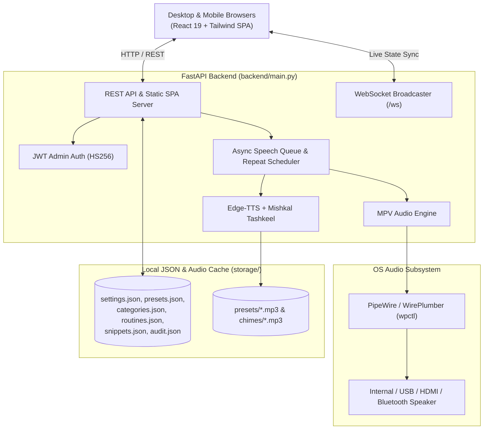

<div align="center">
  
  <h1>Kernel Ping Center</h1>
  <p><strong>Bilingual (Arabic / English) Neural TTS Public Address &amp; Office Audio Announcement System</strong></p>
  <p><em>نظام النداء والإذاعة الصوتي الذكي بالذكاء الاصطناعي لبيئات العمل ومكاتب الدعم الفني</em></p>

  <p>
    
    
    
    
    
  </p>

  <p>
    <a href="#-features">Features</a> •
    <a href="#-architecture">Architecture</a> •
    <a href="#-quick-start">Quick Start</a> •
    <a href="#-configuration">Configuration</a> •
    <a href="#-api-overview">API Overview</a> •
    <a href="docs/README.md">التوثيق العربي (Arabic Docs)</a>
  </p>
</div>

---

## 📖 Overview

**Kernel Ping Center** is a real-time, LAN-accessible Public Address (PA) and office voice announcement web application built with **FastAPI** and **React**. Originally tailored for a **Student IT Support Team**, it turns any workstation, mini-PC, or Linux/Windows server connected to speakers (AUX, USB DAC, HDMI, or Bluetooth) into a centralized announcement hub controllable from desktops and mobile devices on the same Wi-Fi/LAN.

It combines **Microsoft Edge Neural TTS** (`24 kHz` voice synthesis), automatic **Arabic diacritization (Tashkeel)** via `mishkal`, **zero-latency pre-cached audio presets**, **synchronized pre-chime timing**, **auto-repeat broadcasts**, and **150% software volume amplification** via PipeWire/WirePlumber.

---

## ✨ Features

### 🎙️ Neural Speech & Language Engine
- **Bilingual Neural Voices:** Automatic language detection routes Arabic text to `ar-SA-HamedNeural` and English text to `en-US-AndrewMultilingualNeural` (customizable in Admin settings), with configurable speech rate and pitch.
- **AI Arabic Diacritization (Tashkeel):** Built-in `mishkal` integration (`POST /api/tashkeel`) adds Arabic diacritics for accurate pronunciation while preserving English terms and numerals.
- **Zero-Latency Pre-Cached Presets:** Categorized announcement buttons stored with numeric IDs (`storage/presets/{id}_{lang}.mp3`) for near-instant playback without waiting on cloud TTS generation.
- **Free Speech Studio & Quick Snippets:** Type custom announcements (`Ctrl + Enter` to broadcast), insert reusable snippets, or send urgent person/role callouts (`POST /api/speak/call`).
- **Dynamic Routine Actions:** Parameterized call templates (e.g., `"Where is device #{num}?"`) with quick-fill inputs for repetitive daily operations.
- **Auto-Repeat Broadcasts:** Repeat presets or custom messages by iteration count (`1–100`), duration (`0.5–180` min), or continuously until stopped, with configurable intervals (`2–3600` sec).

### 🔊 Audio Pipeline & Hardware Control
- **Synchronized Pre-Chime & Silence Timing:** Choose between `synchronized` (prepares TTS audio first, then plays chime + speech seamlessly) or `instant` chime mode, with selectable chimes (`airport`, `bell`, `alert`) generated via `backend/generate_chimes.py`.
- **DAC Wakeup & Anti-Cutoff Timers:** Configurable `pre_chime_silence` and `inter_chime_delay` (`0.0s–3.0s`) prevent clipped first syllables on sleeping speakers or Bluetooth DACs.
- **Up to 150% Audio Amplification:** Adjust output volume from `0%` to `150%` via WirePlumber (`wpctl set-volume -l 1.5`).
- **Active Audio Sink & Bluetooth Management:** Automatically inspects PipeWire sinks (Internal, USB, HDMI, Bluetooth) and supports Bluetooth speaker status checks and reconnection.
- **Emergency Instant Stop:** Prominent global stop button immediately terminates `mpv` playback, clears queued items, and halts active repeat loops.

### 🖥️ Workspace, Sync & Administration
- **Real-Time Multi-Client Sync:** Combines Optimistic UI updates with auto-reconnecting WebSockets (`/ws`) and `1.5s` fallback polling.
- **Bilingual & Themeable Interface:** Full Arabic (RTL) and English (LTR) localization with Dark/Light mode support.
- **Anti-Spam Cooldown:** Configurable cooldown timer between broadcasts (`cooldown_seconds`, default `15s`).
- **Protected Admin Control Center (`/admin`):** JWT-authenticated dashboard (`HS256`) to manage categories, presets (with ordering & one-click cache rebuild), routines, snippets, audio/TTS settings, voice/chime previews, and a live audit log (`storage/audit.json`, up to 50,000 entries).

---

## 🏗️ Architecture



---

## 📁 Project Structure

```text
kernelping/
├── backend/
│   ├── main.py                 # FastAPI app, REST endpoints, WebSocket & SPA serving
│   ├── audio_engine.py         # Async speech queue, Edge-TTS, MPV playback & Bluetooth/wpctl
│   ├── config.py               # Pydantic models, paths, environment vars & JSON persistence
│   ├── auth.py                 # JWT authentication helpers for /admin
│   ├── tashkeel.py             # Arabic diacritization wrapper using mishkal
│   ├── generate_chimes.py      # Generates airport, bell, and alert chime MP3s
│   └── pregenerate_presets.py  # Batch pre-generator for preset MP3 caches
├── frontend/
│   ├── src/
│   │   ├── components/         # PublicWorkspace, AdminApp, RoutineActions, QuickSnippets, IconPicker
│   │   ├── context/            # Theme & Arabic/English language context
│   │   ├── translations.js     # Unified AR/EN localization dictionary
│   │   └── App.jsx             # Client router (/ and /admin)
│   ├── public/logo.png
│   └── package.json
├── storage/                    # JSON data stores, pre-cached MP3s, chimes & audit logs
├── docs/                       # Comprehensive Arabic documentation suite
├── scripts/
│   └── setup_domain.sh         # Local mDNS (kernelping.local) setup helper
├── kernelping.service          # Systemd service unit template
├── run.sh                      # Development launcher (FastAPI :8000 + Vite :5173)
└── start_production.sh         # Production build & unified server launcher (:8000)
```

---

## 🚀 Quick Start

### 1. System Prerequisites

**Linux (Debian / Ubuntu / Fedora):**
- Python 3.10+ with `venv`
- Node.js & `npm`
- `mpv` and `ffmpeg`
- Audio stack: `pipewire`, `wireplumber`, `pipewire-alsa` (plus `libspa-0.2-bluetooth` for Bluetooth speakers)

```bash
# Example on Debian/Ubuntu:
sudo apt update && sudo apt install -y python3 python3-venv nodejs npm mpv ffmpeg pipewire wireplumber
```

### 2. Clone & Install Dependencies

```bash
git clone <YOUR_GITHUB_REPO_URL> kernelping
cd kernelping

# Create Python virtual environment & install backend dependencies
python3 -m venv venv
source venv/bin/activate
pip install -r requirements.txt

# Install frontend dependencies
cd frontend
npm install
cd ..
```

> **Note:** When installing as a `systemd` service via [`kernelping.service`](kernelping.service), update `User`, `WorkingDirectory`, and `ExecStart` to match your deployment path.

### 3. Run in Development Mode

Starts the FastAPI backend on port `8000` and the Vite dev server on port `5173`:

```bash
./run.sh
```

- **Public Workspace:** `http://localhost:5173/`
- **Admin Control Center:** `http://localhost:5173/admin`
- **Interactive API Docs (Swagger):** `http://localhost:8000/docs`

### 4. Run in Production Mode (Desktop + Mobile LAN Access)

Builds `frontend/dist` and serves both the API and the React SPA from FastAPI on `0.0.0.0:8000`, automatically printing your local Wi-Fi IP for mobile access:

```bash
./start_production.sh
```

Optional local `.local` domain setup via Avahi mDNS:

```bash
./scripts/setup_domain.sh
# Access via http://kernelping.local:8000/
```

---

## ⚙️ Configuration

Backend authentication and JWT settings can be configured via environment variables (defaults are defined in [`backend/config.py`](backend/config.py)):

| Variable | Default | Description |
| :--- | :--- | :--- |
| `KERNELPING_ADMIN_USER` | `admin` | Admin login username |
| `KERNELPING_ADMIN_PASS` | `kernel2026` | Admin login password (change before production use!) |
| `KERNELPING_JWT_SECRET` | `kernelping_stealth_secret_2026_xyz_7721` | Secret key used to sign JWT tokens (`HS256`, 72h expiry) |

Runtime audio, chime, voice, and cooldown preferences are persisted in [`storage/settings.json`](storage/settings.json) and can be updated live from `/admin`.

---

## 📡 API Overview

| Method & Endpoint | Access | Description |
| :--- | :--- | :--- |
| `WS /ws` | Public | Real-time engine status, queue, volume, and repeat updates |
| `GET /api/status` | Public | Current audio engine state, active sink, cooldown & settings |
| `GET /api/categories` & `GET /api/presets` | Public | List announcement categories and presets |
| `POST /api/speak/preset/{preset_id}` | Public | Queue a pre-cached preset announcement |
| `POST /api/speak/custom` | Public | Synthesize and speak custom free text |
| `POST /api/speak/call` | Public | Broadcast an urgent person/role callout |
| `POST /api/speak/repeat` & `POST /api/repeat/stop` | Public | Start or stop an automated repeating announcement |
| `POST /api/tashkeel` | Public | Auto-diacritize Arabic text via `mishkal` |
| `POST /api/routines/{routine_id}/speak` | Public | Trigger a dynamic routine template with a value |
| `POST /api/volume` & `POST /api/audio/stop` | Public | Adjust speaker volume (`0–150`) or immediately stop playback |
| `GET /api/bluetooth/status` & `POST /api/bluetooth/reconnect` | Public | Inspect paired Bluetooth devices or reconnect a speaker |
| `POST /api/auth/login` | Public | Authenticate admin and obtain JWT Bearer token |
| `GET/POST/PUT/DELETE /api/admin/*` | Admin (JWT) | Manage settings, categories, presets, cache rebuilds & audit logs |

Full endpoint schemas and examples are available in [`docs/API_REFERENCE.md`](docs/API_REFERENCE.md) or interactively at `/docs` when the backend is running.

---

## 📚 Documentation Suite (Arabic)

Detailed operational, architectural, and deployment guides are available in [`docs/`](docs/README.md):

- [Documentation Index (`docs/README.md`)](docs/README.md)
- [Admin & Operations Manual (`docs/ADMIN_MANUAL.md`)](docs/ADMIN_MANUAL.md)
- [System Architecture (`docs/ARCHITECTURE.md`)](docs/ARCHITECTURE.md)
- [Audio & Neural TTS Engine (`docs/AUDIO_ENGINE.md`)](docs/AUDIO_ENGINE.md)
- [API & WebSocket Reference (`docs/API_REFERENCE.md`)](docs/API_REFERENCE.md)
- [Debian 13 Deployment Guide (`docs/DEBIAN_DEPLOYMENT.md`)](docs/DEBIAN_DEPLOYMENT.md)
- [Windows 10 Deployment Guide (`docs/WINDOWS_DEPLOYMENT.md`)](docs/WINDOWS_DEPLOYMENT.md)
- [Local Domain Setup (`docs/LOCAL_DOMAIN_SETUP.md`)](docs/LOCAL_DOMAIN_SETUP.md)
