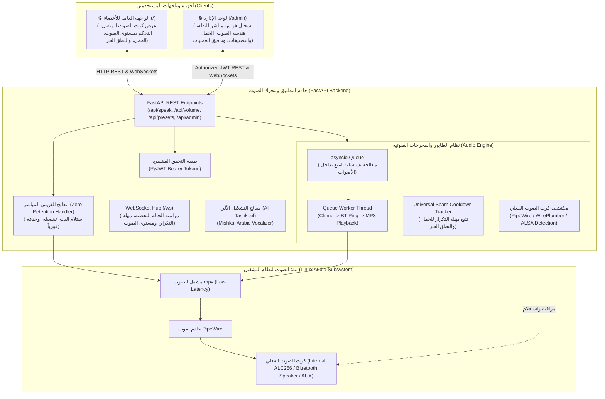

# 🏗️ معمارية وهيكلية نظام Kernel Ping (Architecture Deep Dive)

يقوم نظام **Kernel Ping** على معمارية معيارية حديثة مصممة خصيصاً للتشغيل الموثوق في بيئات العمل المشتركة، مع التركيز على الأداء السريع، عزل الواجهات، ومنع تضارب الصوت نهائياً.

---

## 📐 المخطط المعماري العام (System Architecture Flowchart)

---

## 🏛️ المكونات الأساسية للنظام

### 1. واجهة الأعضاء العامة (Public Workspace)
- واجهة خفيفة وسريعة مصممة بنظام SPA عبر React 19 و Tailwind CSS.
- تتصل بالخادم عبر قناتين:
  - **REST API:** لإرسال الأوامر والنداءات وضبط مستوى الصوت.
  - **WebSocket:** لاستقبال التحديثات اللحظية (تغير حالة البفلة، دوران الطابور، مستوى الصوت، والمهلة المتبقية).
- تتيح لأي عضو معرفة كرت الصوت الفعلي المتصل وضبط درجة علو الصوت مباشرة.

### 2. لوحة الإدارة والتحكم (Admin Control Center)
- لوحة محمية بمصادقة مشفرة عبر JWT (JSON Web Tokens).
- تدمج الواجهة العامة بالكامل لإتاحة الاستخدام السريع، مع إضافة استديو التسجيل الصوتي المباشر (Voice Broadcast Studio) للبث إلى البفلة مع الحذف الفوري التام.
- إدارة تصنيفات الجمل (بما فيها خيار "غير مصنف").
- سجل العمليات والتدقيق مع تأكيد الحذف لمنع الأخطاء البشرية.

### 3. خادم التطبيق ومحرك الصوت (FastAPI & AudioEngine)
- مبني على لغة Python 3 بنظام غير متزامن بالكامل (`asyncio`).
- نظام طابور تسلسلي يمنع تراكب الأصوات أو انقطاعها.
- كشف ذكي عن كرت الصوت النشط والتفريق بين المخرج الداخلي والسماعة الخارجية.
- تحكم مستقل بمستوى صوت نغمات التنبيه المسبقة.

### 4. محرك توقيت النغمة المتزامن (Synchronized Chime Engine)
- **دورة المعالجة المتزامنة (Zero Gap Audio Cycle):**
  1. استلام الطلب ووضعه في طابور `asyncio.Queue`.
  2. سحب العنصر وتوليد الصوت عبر `edge-tts` (أو جلب ملف الـ MP3 المخزن محلياً).
  3. التأكد من جهوزية الملف الصوتي على القرص 100%.
  4. إطلاق نغمة التنبيه (Pre-Chime) على مستوى الصوت المحدد.
  5. تطبيق مهلة إيقاظ البلوتوث (400ms).
  6. تشغيل الصوت فوراً عبر `mpv` دون أي ثانية صمت أو تأخير بعد النغمة.

### 5. نظام الإيقاف الطارئ وحماية البث المباشر (Emergency Stop & Mic Protection)
- يتيح إنهاء عملية تشغيل `mpv` النشطة وتفريغ طابور النداءات وإعادة النظام لحالة `ready`.
- **طبقة أمان مخصصة للبث المباشر للمشرف (`source: admin_voice`):**
  - عند بث صوت بشري مباشر من مايك المشرف، يُحظر على الأعضاء إيقافه نهائياً من الواجهة أو عبر الـ API.
  - يتحقق مسار `/api/audio/stop` في الباك إند من توكن المشرف المشفر (`JWT`)؛ وإذا لم يكن المشرف هو من طلب الإيقاف، يتم إرجاع استجابة `HTTP 403 Forbidden` فوراً لحماية الرسالة الصوتية الحية من المقاطعة.
