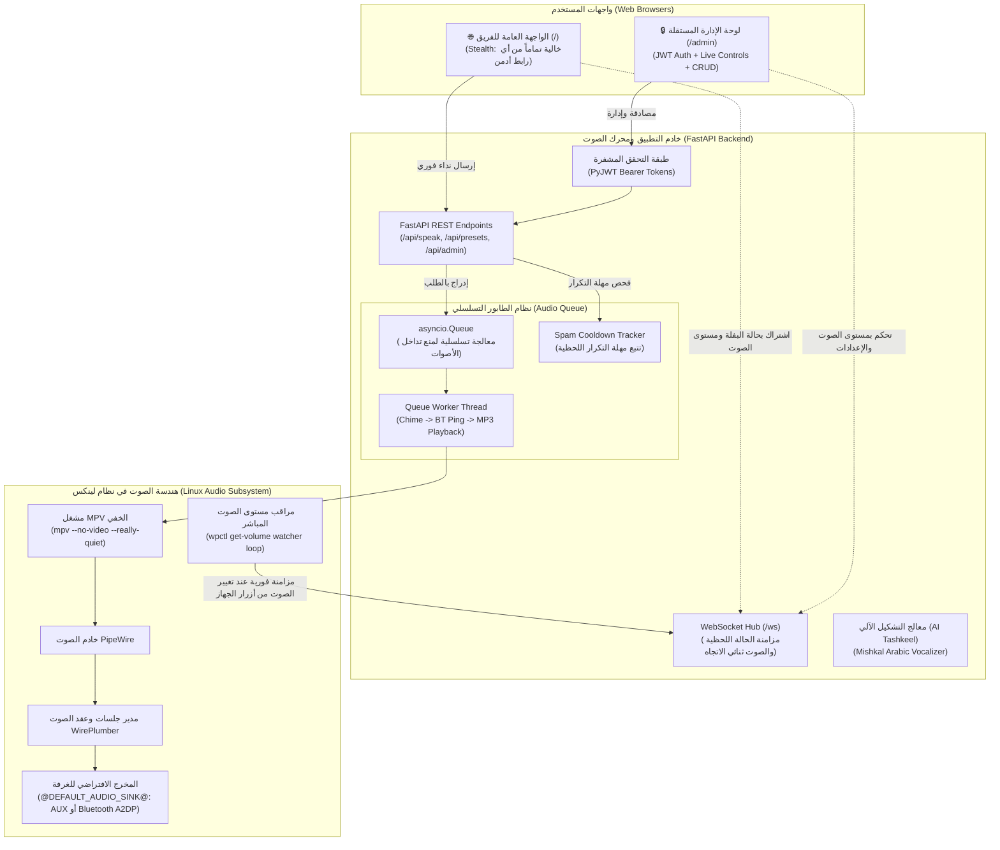

# 🏗️ معمارية وهيكلية نظام Kernel Ping (Architecture Deep Dive)

يقوم نظام **Kernel Ping** على معمارية معيارية حديثة مصممة خصيصاً للتشغيل الموثوق في بيئات العمل المشتركة، مع التركيز على الأداء السريع، عزل الواجهات، ومنع تضارب الصوت نهائياً.

---

## 📐 المخطط المعماري العام (System Flow Diagram)



---

## 🔒 1. فلسفة الإدارة الخفية (Stealth Admin Architecture)

من أهم الركائز التصميمية لنظام Kernel Ping هو الفصل التام بين تجربة أعضاء الفريق وتجربة الإدارة:

1. **انعدام الأثر (Zero Digital Footprint in Public):**
   - الواجهة العامة المتاحة للأعضاء على المسار `/` لا تحتوي على:
     * أي زر تسجيل دخول (Login Button).
     * أي أيقونة قفل، ترس، أو رابط مخفي.
     * أي نافذة منبثقة (Modal) أو خيار يحيل إلى الإدارة.
   - الشخص العادي الذي يتصفح النظام لا يمكنه معرفة أو استنتاج وجود لوحة تحكم إدارية.

2. **الوصول المباشر والحصري عبر المسار (`/admin`):**
   - للوصول إلى لوحة التحكم، يتعين على المسؤول كتابة الرابط يدوياً في شريط المتصفح: `http://kernelping.local:8000/admin`.
   - عند محاولة الدخول لغير المصرح لهم، تفتح شاشة دخول مستقلة تماماً ومحمية بجلسة مشفرة عبر توكنات `JWT` (JSON Web Token) المنتهية الصلاحية تلقائياً بعد 72 ساعة.

---

## 🔊 2. هندسة الصوت والطابور التسلسلي (Audio Queue & PipeWire)

1. **منع تداخل الأصوات (Zero Collision Concurrency):**
   - بدلاً من تشغيل ملفات الصوت فور وصول الطلب، يتم إرسال كافة النداءات عبر طابور غير متزامن `asyncio.Queue()`.
   - يقوم عامل الطابور (`_queue_worker`) بسحب النداءات ومعالجتها نداءً تلو الآخر، مما يضمن استحالة تشغيل صوتين فوق بعضهما في سماعة المكتب.

2. **تجريد مخرج الصوت (Audio Sink Abstraction):**
   - يعتمد النظام على مخرج الصوت الافتراضي عبر خادم **PipeWire** ومتحكم **WirePlumber**:
     ```bash
     wpctl set-volume @DEFAULT_AUDIO_SINK@ <value>
     ```
   - هذا التجريد العبقري يتيح للنظام العمل بسلاسة مطلقة بغض النظر عن طريقة توصيل السماعة:
     * سلك تناظري AUX 3.5mm.
     * كابل USB DAC / Sound Card خارجي.
     * اقتران بلوتوث بتقنية A2DP عالية الجودة.

3. **المزامنة ثنائية الاتجاه لمستوى الصوت (Bi-directional Volume Sync):**
   - يعمل داخل محرك الصوت مسار مراقبة خفيف (`_volume_monitor_loop`) يفحص مخرج الصوت الحقيقي كل 1 ثانية.
   - إذا قام أي شخص بخفض أو رفع الصوت من أزرار الكيبورد في جهاز السيرفر أو عبر قائمة KDE Tray، يكتشف المحرك التغيير فوراً ويبث القيمة الحقيقية الجديدة لجميع متصفحات الفريق المفتوحة عبر WebSocket!

4. **إصلاح وحساب مانع الإزعاج (Spam Cooldown Calculation):**
   - يتم احتساب مهلة التكرار المحددة (مثلاً 15 ثانية) بدءاً من **لحظة ضغط الزر وإدراج النداء في الطابور (`last_enqueued_time`)** وليس من لحظة انتهاء نطق الصوت.
   - هذا الإصلاح يمنع حرمان المستخدمين من الإرسال بعد انتظارهم للمهلة المحددة، ويضمن تزامن عداد الواجهة بدقة مع رفض أو قبول السيرفر.

---

## 🛠️ 3. الحزمة التقنية الكاملة (Technology Stack)

| الطبقة | التقنية المستخدمة | الدور الأساسي |
| :--- | :--- | :--- |
| **Backend Core** | Python 3.14 + FastAPI + Uvicorn | معالجة الـ REST API، إدارة التوكنات، وخدمة ملفات الـ SPA. |
| **Realtime Gateway**| WebSockets (`/ws`) | بث حالة البفلة اللحظية (جاهزة / قيد النطق / في الطابور) ومزامنة الصوت. |
| **TTS Engine** | Edge-TTS (Neural Synthesis) | توليد الكلام البشري الفائق من النصوص العربية والإنجليزية. |
| **Arabic Diacritizer**| Mishkal NLP Core | تشكيل النص العربي تلقائياً لضبط الحركات ومنع عيوب النطق. |
| **Audio Playback** | MPV Player (`--no-video`) | تشغيل ملفات MP3 بخلفية النظام بأقل استهلاك لموارد المعالج. |
| **Frontend Framework**| React 19 + Vite 6 | بناء واجهة مستخدم سريعة، تفاعلية، وخفيفة الوزن. |
| **Styling & Icons** | Tailwind CSS + Lucide React | تصميم عصري متناسق مع هوية كيرنال تك مع دعم كامل للدارك واللايت مود. |

