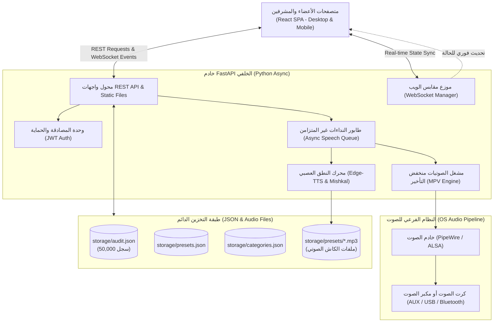
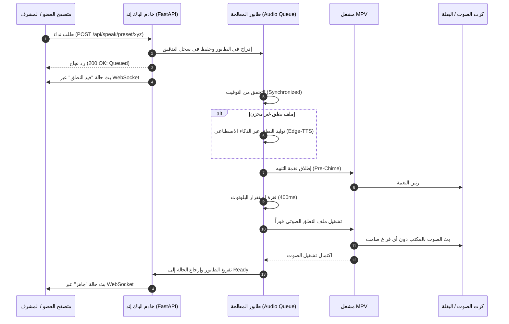

# 🏗️ هيكلية ومعمارية النظام (Kernel Ping Center — Architecture)

يوثق هذا المستند المعمارية التقنية والتصميم الداخلي لنظام **Kernel Ping Center**، ومسار تدفق البيانات بين الواجهات الأمامية التفاعلية، الخادم الخلفي غير المتزامن، ومحرك هندسة وبث الصوت.

---

## 📐 1. المخطط الهيكلي العام (High-Level Architecture)



---

## ⚡ 2. نموذج التفاعل اللحظي (Real-time Reactivity Model)

يعتمد النظام على تركيبة ثلاثية الأبعاد تضمن سرعة استجابة فائقة بنسبة 100% ودون الحاجة لتحديث الصفحة يدوياً:

1. **التحديث التفاؤلي الفوري (Optimistic State Update):**
   - بمجرد نقر المستخدم على زر النداء أو زر إيقاف الصوت، تنتقل الواجهة محلياً في زمن `0ms` إلى حالة "جاري النطق" أو "جاهز" لتوفير استجابة بصرية فورية ومنع تكرار النقر.
2. **مقابس الويب ذاتية إعادة الاتصال (Auto-Reconnecting WebSockets):**
   - ترسل خوادم FastAPI إشعارات فورية عبر قناة `/ws` بمجرد تغير حالة الطابور الصوتي أو مستوى الصوت لجميع المتصفحات المتصلة.
   - إذا حدث انقطاع في الشبكة أو سكون في المتصفح، تعيد الواجهة الاتصال تلقائياً كل 1.5 ثانية.
3. **المزامنة الدورية الاحتياطية (Fallback Polling):**
   - استدعاء خلفي خفيف لنقطة `/api/status` كل 1.5 ثانية يضمن مزامنة دقيقة حتى لو كانت بيئة المتصفح تقيد الـ WebSocket في الخلفية.

---

## 🔊 3. خط أنابيب الصوت وهندسة البث (Audio Processing Pipeline)



---

## 📁 4. الهيكل التنظيمي للمشروع (Directory Structure)

```
kernelping/
├── backend/                  # خادم البايثون الخلفي (FastAPI Engine)
│   ├── main.py               # نقاط الـ REST API ومقابس الـ WebSocket
│   ├── audio_engine.py       # محرك الصوت وتوليد النطق وتشغيل MPV
│   ├── config.py             # قراءة وكتابة الإعدادات وموديلات Pydantic
│   ├── auth.py               # مصادقة وتشفير المشرف عبر JWT
│   └── generate_chimes.py    # مولد نغمات التنبيه التلقائي
├── frontend/                 # الواجهة الأمامية الحديثة (React SPA)
│   ├── src/
│   │   ├── components/       # مكونات الواجهة (PublicWorkspace, AdminApp, RoutineActions)
│   │   ├── context/          # إدارة المظهر المظلم/الفاتح وتغيير اللغات
│   │   ├── translations.js   # قواميس التوطين الموحدة (العربية والإنجليزية)
│   │   └── App.jsx           # موجه المسارات الرئيسي
│   ├── dist/                 # حزم الإنتاج المجمعة والمحسنة للسرعة
│   └── package.json          # حزم واعتماديات React و Vite و Tailwind
├── storage/                  # قاعدة البيانات والمستودع الصوتي
│   ├── audit.json            # سجل التدقيق (يتسع لـ 50,000 عملية)
│   ├── presets.json          # الجمل الثابتة المعتمدة
│   ├── categories.json       # تصنيفات فريق الـ IT الطلابي
│   ├── routines.json         # قوالب النداءات السريعة
│   ├── snippets.json         # الاقتراحات السريعة
│   ├── settings.json         # إعدادات الصوت والنغمات ومهلة التكرار
│   ├── presets/              # ملفات النطق الصوتي المخزنة محلياً (.mp3)
│   └── chimes/               # ملفات نغمات التنبيه (.mp3)
├── docs/                     # التوثيق الرسمي الشامل للمشروع
├── run.sh                    # سكربت تشغيل بيئة التطوير
└── start_production.sh       # سكربت الإنتاج الموحد وخادم الـ IP التلقائي
```

---

## 🔒 5. معايير الأمان وحماية البيانات (Security & Reliability)

- **حماية لوحة الإدارة:** تشفير كلمات المرور باستخدام JWT Tokens مع مدة صلاحية قابلة للضبط وحفظ التوكن في التخزين المحلي الآمن.
- **منع الإغراق والإزعاج (Anti-Spam Cooldown):** مهلة تكرار ديناميكية (افتراضياً 15 ثانية) تحمي المكتب من تكرار نفس النداء أو إرسال طلبات متعددة بالخطأ.
- **استمرارية السيرفر:** تم ضبط النظام ليعمل كخدمة نظام مستقلة تعيد تشغيل نفسها فوراً في حال حدوث أي خطأ عارض أو إعادة تشغيل الجهاز.
