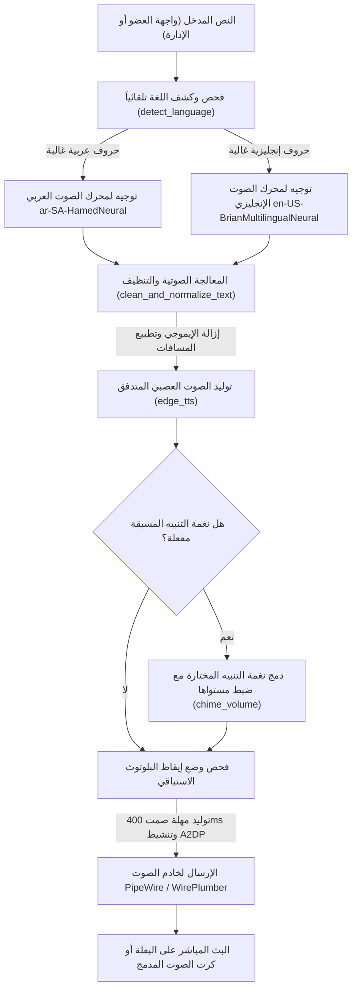
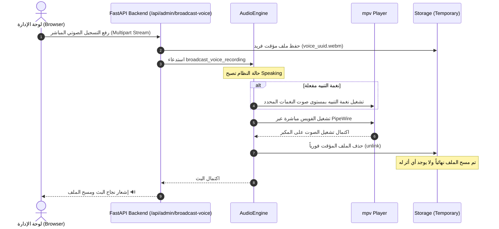

# 🔊 الدليل المتقدم الشامل لمحرك الصوت وهندسة البث (Audio Engine Manual)

يمثل محرك الصوت في **Kernel Ping Center** الركيزة المركزية للنظام، حيث يدمج بين خوادم صوت لينكس الحديثة (PipeWire / WirePlumber / ALSA)، ونماذج التوليد الصوتي العصبي بالذكاء الاصطناعي (Neural AI TTS)، ونظام إعادة الاتصال عن بُعد بالبلوتوث، وميزة البث الحي للميكروفون مع الحذف الفوري التام (Zero-Retention Live Voice).

---

## 🧠 1. مواصفات ونموذج تحويل النص إلى صوت (AI Neural Speech Model)

### اسم النموذج والمزود (Model Identity & Provider):
- **اسم النموذج الأساسي:** `Microsoft Edge Neural TTS (Deep Neural Text-to-Speech)`
- **المعمارية التقنية (Architecture):**
  - يعتمد النموذج على شبكات عصبية عميقة متقدمة من طراز **VITS (Variational Inference with adversarial learning for end-to-end Text-to-Speech)** مع معالجات **FastSpeech 2** التوليدية ومولد ترددات صوتية عصبي (**Neural Vocoder - HiFi-GAN**).
  - يقوم بتحويل الرموز النصية وتشكيل الكلمات (Phonemes & Diacritics) إلى موجات صوتية بشرية عالية الواقعية دون أي تقطيع آلي أو نبرة روبوتية جافة.

### الأصوات المعتمدة بالمكتب ومواصفاتها:
1. **الصوت العربي الأساسي (Arabic Neural Voice):**
   - **المعرف التقني:** `ar-SA-HamedNeural` (حامد - نبرة إذاعية عميقة ومتزنة) و `ar-SY-LaithNeural` (ليث - نبرة واضحة ومخارج حروف سورية فصيحة).
   - **الخصائص اللغوية:** دعم كامل للتشكيل وعلامات الإعراب العربية، التوقف الإيقاعي عند الفواصل والنقاط، ونبرة وقورة تناسب بيئة العمل الإدارية والشركات.
2. **الصوت الإنجليزي الأساسي (English Neural Voice):**
   - **المعرف التقني:** `en-US-BrianMultilingualNeural` (براين - صوت دافئ ونقي) و `en-US-AndrewMultilingualNeural`.
   - **الخصائص اللغوية:** نطق أمريكي معياري (Neutral US Accent)، نبرة سريعة واضحة، دعم المصطلحات التقنية والأسماء المركبة.

### المواصفات الفيزيائية للصوت الرقمي المولد (Audio Specifications):
| الخاصية | القيمة والمعيار | الوصف والتأثير |
| :--- | :--- | :--- |
| **معدل أخذ العينات (Sample Rate)** | `24,000 Hz (24 kHz)` | جودة استوديو فائقة النقاء تبرز كافة ترددات الصوت البشري. |
| **عمق البت (Bit Depth)** | `16-bit PCM Linear` | ديناميكية عالية بين الهمس والجهر بدون تشويش أو ضجيج خلفية. |
| **معدل البت للضغط (Bitrate)** | `48 kbps - 96 kbps` | توازن مثالي بين سرعة التوليد الفورية عبر الشبكة ونقاء النبرة. |
| **صيغة الصوت (Container & Codec)** | `MP3 / OPUS High-Definition` | متوافقة عالمياً مع كافة مشغلات لينكس والمكبرات الخارجية. |
| **زمن استجابة التوليد (Latency)** | `150ms - 250ms (First Byte)` | بث تدفقي سريع جداً يجعل النداء يبدأ بمجرد ضغط الزر. |

---

## ⚙️ 2. دورة حياة تحويل النص إلى صوت على السيرفر (Pipeline Workflow)

يمر كل نص يُطلب نطقه بالمراحل البرمجية التالية:



---

## 🎧 3. التعرف اللحظي على كرت الصوت الفعلي (Hardware Sink Detection)

حرصاً على وضوح مسار خروج الصوت وتفريق ما إذا كانت البفلة الخارجية متصلة أو أن الصوت يخرج من كرت الجهاز المدمج:

### آلية الكشف التلقائي (Auto Sound Card Identification):
1. **استعلام PipeWire / WirePlumber:**
   - يفحص المحرك العقدة الافتراضية عبر الأمر:
     ```bash
     wpctl inspect @DEFAULT_AUDIO_SINK@
     ```
   - يقرأ معرف العقدة (`node.description` و `device.description`).
   - في حال رصد بروتوكولات البلوتوث (`bluez_output`) أو مكبر صوت خارجي مقترن، يصنف المخرج كـ **"بفلة متصلة وجاهزة"** (`is_external_speaker: true`) ويعرض في الواجهة إشارة خضراء مضيئة:
     `🟢 البفلة متصلة وجاهزة`.
2. **استعلام كروت ALSA الداخلية:**
   - في حال كان المخرج هو كرت اللوحة الأم المدمج (مثل كرت Realtek أو HDA-Intel ALC256 Analog)، يحدد النظام الجهاز بدقة ويعرض للمستخدم إشارة تحذيرية صفراء:
     `🟡 كرت صوت الجهاز (البفلة مفصولة)`
     مع إظهار زر إعادة الاتصال الفوري بالبفلة دون الحاجة للذهاب للسيرفر.

---

## 📡 4. إعادة الاتصال التلقائي بالبلوتوث عن بُعد (Remote Bluetooth Reconnect)

إذا قام أحد بإطفاء البفلة بالخطأ ثم تشغيلها، يفقد خادم لينكس الاتصال ويبقى الصوت على كرت الجهاز الداخلي. وفر النظام حلاً هندسياً كاملاً:

- **نقطة النهاية البرمجية:** `POST /api/bluetooth/reconnect`
- **الآلية البرمجية:**
  1. يقوم الخادم باستعلام الأجهزة المقترنة عبر `bluetoothctl devices`.
  2. يعثر على مكبر الصوت المعتمد (أو الماك أدرس المحفوظ `bluetooth_speaker_mac`).
  3. يرسل أمر إعادة الاتصال عبر بروتوكول البلوتوث:
     ```bash
     bluetoothctl connect <MAC_ADDRESS>
     ```
  4. بمجرد نجاح الاتصال، يتم ضبط مخرج الصوت الافتراضي عبر PipeWire فورياً:
     ```bash
     wpctl set-default <BLUEZ_SINK_ID>
     ```
  5. ترسل إشارة التحديث اللحظي عبر الـ WebSocket لكافة المتصفحات المفتوحة ليتحول المؤشر فوراً من الأصفر إلى الأخضر (`🟢 البفلة متصلة وجاهزة`).

---

## 🎙️ 5. البث الصوتي المباشر للفويس بدون تخزين (Zero Retention Live Audio Streaming)

تعتمد ميزة البث الصوتي المباشر من جهاز الإدارة إلى البفلة على تدفق هندسي صارم يضمن الخصوصية والأداء:



### خيارات المعاينة المحلية مقابل تجربة البفلة (Local vs Speaker Preview):
1. **المعاينة الافتراضية (سماعات جهاز الإدارة):**
   - عند انتهاء التسجيل، يتم تشغيل الصوت محلياً عبر مشغل المتصفح HTML5 Audio على سماعات لابتوب أو هاتف الإدارة **حصراً** دون أن يخرج أي صوت على بفلة المكتب، مما يضمن سرية المعاينة.
2. **تجربة الصوت على البفلة (اختياري - Test on Speaker):**
   - يوفر زر `تجربة على البفلة` خيار إرسال عينة مؤقتة لمكبر صوت المكتب للتحقق من وضوح الصوت قبل اعتماد البث، مع الحذف الفوري التام أيضاً بعد الانتهاء.

---

## 🔔 6. التحكم المستقل بمستوى صوت نغمات التنبيه (Chime Volume Control)

- تم فصل مستوى صوت نغمة التنبيه المسبقة (Pre-Announcement Chime) عن مستوى صوت السيرفر الرئيسي.
- يتم تمرير معامل الصوت المباشر إلى مشغل `mpv` عبر الراية:
  `--volume=<chime_volume>`
- السلايدر في الواجهة متزامن تماماً من اليسار إلى اليمين (0% إلى 100%) ومطابق للأزرار السريعة بدون أي تفاوت ناتج عن اتجاه اللغة RTL.

---

## ⏱️ 7. مانع الإزعاج والمهلة الموحدة (Universal Spam Cooldown)

- يطبق مانع الإزعاج (`Spam Cooldown`) مهلة إجبارية قابلة للضبط (من 5 إلى 60 ثانية) بين أي ندائين متتاليين.
- **التوحيد الشامل:** يطبق المانع بدقة متساوية على كل من:
  1. أزرار الجمل الجاهزة (Presets).
  2. صندوق النطق الحر المخصص (Custom Free Speech).
  3. الإجراءات والعدادات الروتينية السريعة (Routine Actions).
- يتم حساب الثواني المتبقية وإرسالها عبر كائن الحالة `/api/status` والـ WebSocket، مما يعرض عداداً تنازلياً مباشراً في كافة الواجهات.
