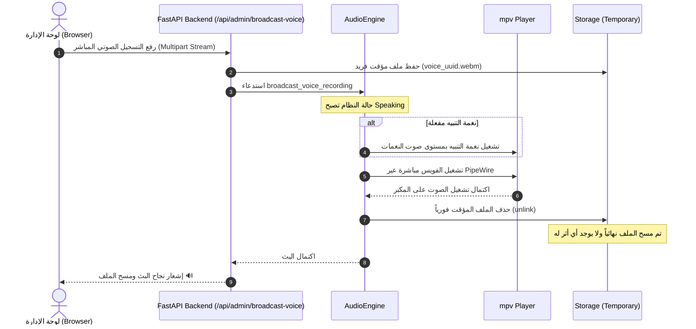

# 🔊 الدليل المتقدم لمحرك الصوت وهندسة البث (Audio Engine Manual)

يمثل محرك الصوت في **Kernel Ping** الركيزة المركزية للنظام، حيث يدمج بين خوادم صوت لينكس الحديثة (PipeWire / WirePlumber / ALSA)، ونماذج التوليد الصوتي العصبي بالذكاء الاصطناعي، وميزة البث الحي للميكروفون مع الحذف الفوري التام.

---

## 🎧 1. التعرف اللحظي على كرت الصوت الفعلي (Hardware Sink Detection)

حرصاً على وضوح مسار خروج الصوت وتفريق ما إذا كانت البفلة الخارجية متصلة أو أن الصوت يخرج من كرت الجهاز المدمج:

### آلية الكشف التلقائي (Auto Sound Card Identification):
1. **استعلام PipeWire / WirePlumber:**
   - يفحص المحرك العقدة الافتراضية عبر `wpctl inspect @DEFAULT_AUDIO_SINK@`.
   - يقرأ معرف العقدة (`node.description` و `device.description`).
   - في حال رصد بروتوكولات البلوتوث (A2DP / Bluez) أو كروت الصوت الخارجية (USB / DAC)، يصنف المخرج كـ **"مكبر صوت خارجي / بفلة"** ويعرض للمستخدم: *"البفلة جاهزة"*.
2. **استعلام كروت ALSA الداخلية:**
   - في حال كان المخرج هو كرت اللوحة الأم المدمج (مثل كرت Realtek أو HDA-Intel ALC256 Analog)، يحدد النظام الجهاز بدقة ويعرض للمستخدم: *"صوت الجهاز جاهز"* مع توضيح اسم الكرت في نافذة التحكم:
     `HD-Audio Generic (ALC256 Analog) - كرت الصوت المدمج بالجهاز`.
3. **مزامنة مستوى الصوت اللحظي (Volume Polling & Sync):**
   - يعمل مراقب صوتي خفيف في الخلفية (`_volume_monitor_loop`) لمطابقة سلايدر الواجهة مع أي تغيير في مستوى صوت نظام التشغيل عبر الـ WebSocket بشكل فوري.

---

## 🎙️ 2. البث الصوتي المباشر للفويس بدون تخزين (Zero Retention Live Audio Streaming)

تعتمد ميزة البث الصوتي المباشر من جهاز الإدارة إلى البفلة على تدفق هندسي صارم يضمن الخصوصية والأداء:

### معايير الأمان والخصوصية:
- **Zero Retention:** لا يتم إدراج ملفات الصوت في أي قاعدة بيانات أو مجلدات دائمة. يتم تنفيذ أمر `unlink()` في كتلة `finally:` البرمجية لضمان الحذف حتى لو حدث أي انقطاع أثناء التشغيل.
- **Audit Record:** يسجل سجل التدقيق فقط أن هناك بثاً صوتياً مباشراً تم من الإدارة مع الإشارة إلى أنه `[تسجيل صوتي مباشر من الإدارة - لم يتم حفظه]`.

---

## 🔔 3. التحكم المستقل بمستوى صوت نغمات التنبيه (Chime Volume Control)

- تم فصل مستوى صوت نغمة التنبيه المسبقة (Pre-Announcement Chime) عن مستوى صوت السيرفر الرئيسي.
- يتم تمرير معامل الصوت المباشر إلى مشغل `mpv` عبر الراية:
  `--volume=<chime_volume>`
- يتيح ذلك جعل نغمة التنبيه هادئة ولطيفة (مثلاً 50%) بينما يكون نطق الكلمات واضحاً وعالياً، أو العكس بحسب رغبة الإدارة.

---

## ⏱️ 4. مانع الإزعاج والمهلة الموحدة (Universal Spam Cooldown)

- يطبق مانع الإزعاج (`Spam Cooldown`) مهلة إجبارية قابلة للضبط (مثلاً 15 ثانية) لمنع إغراق البفلة بالنداءات المتتالية.
- **التوحيد الشامل:** يطبق المانع بدقة متساوية على كل من:
  1. أزرار الجمل الجاهزة (Presets).
  2. صندوق النطق الحر المخصص (Custom Free Speech).
- يتم حساب الثواني المتبقية وإرسالها عبر كائن الحالة `/api/status` والـ WebSocket، مما يجعل زر النطق الحر يعرض عداداً تنازلياً:
  *(يرجى الانتظار 12 ثانية...)* مع تعطيل الإرسال لحين انتهاء المهلة.

---

## 🧠 5. الكشف الذكي عن لغة الجملة واختيار المحرك الصوتي

- عند إضافة أو تعديل أي جملة نداء، لم يعد المسؤول بحاجة لملء حقلين منفصلين للغتين.
- يُدخل المسؤول عنواناً واحداً ونصاً واحداً.
- يقوم المحرك بتحليل الحروف:
  - **إذا كانت الحروف عربية:** يوجه النص إلى محرك الصوت العربي العصبي (`tts_voice_ar` مثل `ar-SY-LaithNeural` أو `ar-SA-HamedNeural`).
  - **إذا كانت الحروف إنجليزية:** يوجه النص إلى محرك الصوت الإنجليزي العصبي (`tts_voice_en` مثل `en-US-BrianMultilingualNeural`).
- العناوين والنصوص ثابتة ولا تتأثر بتبديل لغة الواجهة من العربية للإنجليزية أو العكس.
